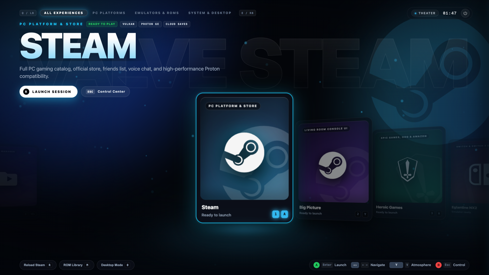
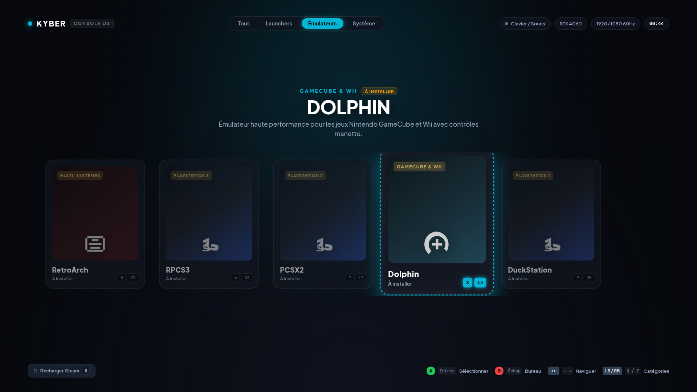
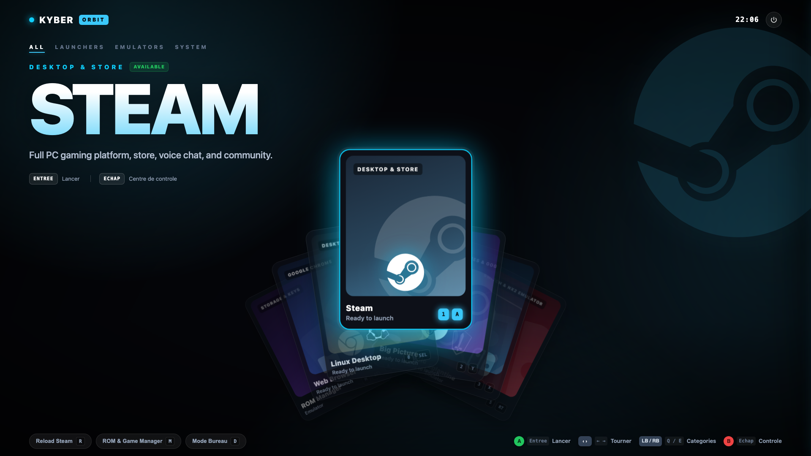
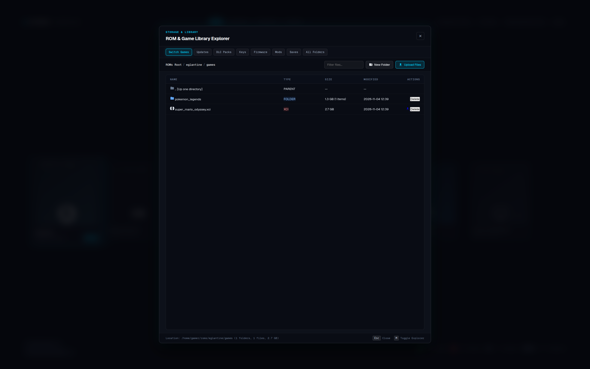
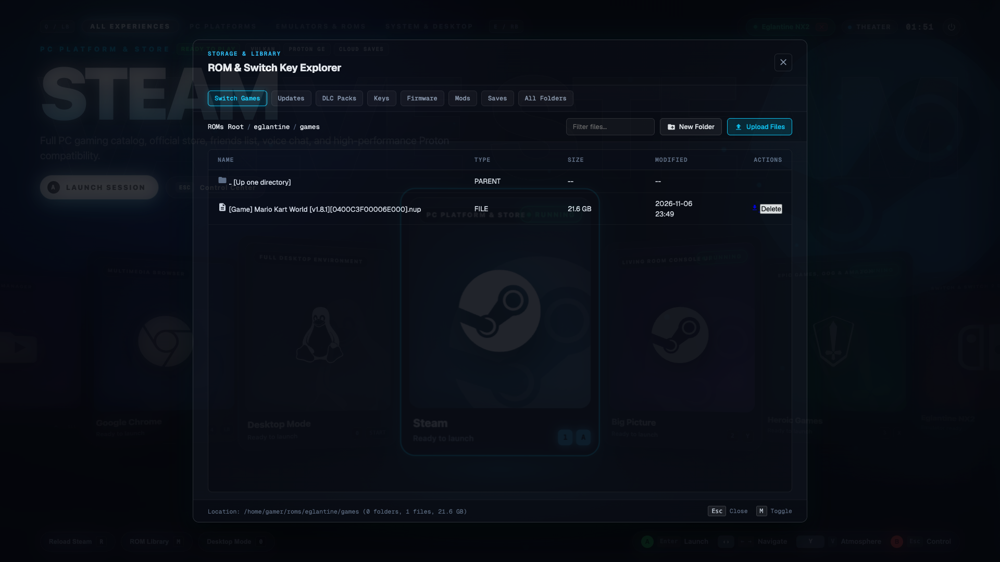

<div align="center">

# KYBER CLOUD GAMING

**Next-Generation Headless Cloud Gaming & Emulation Infrastructure**

Low-latency WebTransport/QUIC streaming, virtual display emulation, Steam Big Picture, modern console emulators, and integrated game storage management.

[](https://github.com/DimitriTimoz/kyber-gaming/releases/latest)
[](https://github.com/DimitriTimoz/kyber-gaming/pkgs/container/kyber-gaming)
[](https://github.com/DimitriTimoz/kyber-gaming)
[-10b981?style=for-the-badge&logo=tauri&logoColor=white)](https://github.com/DimitriTimoz/kyber-gaming/releases/latest)
[](https://github.com/DimitriTimoz/kyber-gaming)
[](LICENSE)

<br/>



</div>

---

## Overview

**Kyber Cloud Gaming** turns any Linux workstation, homelab server, or cloud VM into a high-performance personal cloud gaming platform. Powered by the ultra-low latency **Kyber protocol** (developed by VideoLAN / VLC engineers) and built on **Ubuntu 24.04 LTS**, it delivers buttery-smooth remote gameplay directly to web browsers and native desktop apps with zero HDMI dummy plugs required.

### Core Highlights

- **Headless Virtual Display**: Full hardware 3D acceleration without a physical monitor. Dynamically scales resolution and refresh rate (up to 4K @ 144Hz) to match your client viewport in real time.
- **WebTransport & QUIC Streaming**: Single-port UDP multiplexing for sub-frame video delivery, bidirectional gamepad/keyboard/mouse input, and PipeWire stereo audio.
- **Console OS Launcher Suite**: Built-in launcher interface featuring Steam Big Picture, Heroic Games Launcher (Epic Games & GOG), and Eglantine (Nintendo Switch & NX2 emulator with Vulkan backend).
- **Integrated Storage & ROM Manager**: Dedicated Web and Desktop file explorer with chunked upload engine (10+ GB ROMs), automatic encryption key synchronization (`prod.keys`, `title.keys`), archive extraction, and directory management.
- **Cross-Platform Clients**: Play instantly in any modern web browser or use the native Rust/Tauri v2 desktop client for macOS, Windows, and Linux.

---

## Visual Tour

<div align="center">

### Console OS Hub & Switch 2 Emulation (Eglantine NX2)


<br/>

### Native Tauri v2 Desktop Client (Multi-Server Fleet & Live Latency)


<br/>

### Desktop ROM & Game Library Explorer (Multi-Gigabyte Streaming)


<br/>

### In-Session Console Storage Overlay (Fast Keys & Game Sync)


</div>

---

## Architecture

```
+---------------------------------------------------------------------------------+
|                               HOST SERVER (Linux)                               |
|                                                                                 |
|  +---------------------------+       +---------------------------------------+  |
|  | GPU Hardware Acceleration |       | PipeWire Virtual Audio Subsystem      |  |
|  | NVIDIA (NVENC/NvFBC)      |       | Low-latency PCM / Opus capture        |  |
|  | AMD (RADV/VA-API) / Intel |       +---------------------------------------+  |
|  +-------------+-------------+                           |                      |
|                |                                         |                      |
|  +-------------v-----------------------------------------v-------------------+  |
|  | Virtual Display Engine (X11 Virtual Screen + Auto Dynamic EDID)           |  |
|  | Steam Big Picture  |  Heroic Games Launcher  |  Eglantine (Switch/NX2)    |  |
|  +-----------------------------------+---------------------------------------+  |
|                                      |                                          |
|  +-----------------------------------v---------------------------------------+  |
|  | Kyber Streaming Server (VideoLAN / VLC Engine)                            |  |
|  | HTTP/3 WebTransport + QUIC Datagrams + Sub-frame Input Injection         |  |
|  +-----------------------------------+---------------------------------------+  |
|                                      | Port 8080 (Stream) & Port 8081 (Control) |
+--------------------------------------|------------------------------------------+
                                       |
                   +-------------------+-------------------+
                   |                                       |
                   v                                       v
    +------------------------------+       +------------------------------+
    |   Zero-Install Web Client    |       |   Native Tauri v2 Client     |
    |   Chrome, Edge, Safari,      |       |   macOS (Apple Silicon/Intel)|
    |   Firefox via WebTransport   |       |   Windows (MSI/EXE) & Linux  |
    +------------------------------+       +------------------------------+
```

---

## Quick Start

### 1. Requirements

- Host OS: Linux (Ubuntu, Debian, Fedora, Arch, or Proxmox VE)
- Container Runtime: Docker and Docker Compose v2
- GPU:
  - **NVIDIA**: GeForce GTX 900+ / RTX series with NVIDIA Container Toolkit
  - **AMD**: Radeon RX series with DRI `/dev/dri` access
  - **Intel**: Iris Xe / Arc or UHD Graphics with DRI `/dev/dri` access

### 2. Launch with Docker Compose

Create a `docker-compose.yml` file:

```yaml
services:
  kyber-gaming:
    image: ghcr.io/dimitritimoz/kyber-gaming:latest
    container_name: kyber-gaming
    restart: unless-stopped
    network_mode: host
    privileged: true
    environment:
      - RESOLUTION=1920x1080
      - REFRESH_RATE=60
      - LAUNCHER=menu
      - AUTH_USER=gamer
      - AUTH_PASSWORD=kybergaming
    volumes:
      # 1. Dedicated Games Library (Steam, Heroic, ROMs, BIOS, Saves)
      - kyber_games:/games
      # 2. Persistent User Configuration (Steam login, tokens, emulator configs)
      - kyber_config:/home/gamer
      # Optional: Direct host/NAS mount for your existing games & ROMs
      # - /mnt/storage/games:/games
    devices:
      # Required for hardware acceleration & virtual inputs
      - /dev/dri:/dev/dri
      - /dev/uinput:/dev/uinput

volumes:
  kyber_games:
  kyber_config:
```

Start the container:

```bash
docker compose up -d
```

Check startup logs:

```bash
docker compose logs -f
```

---

## Client Applications

### Option A: Zero-Install Web Client

Open your browser and navigate to:
```
https://<SERVER_IP>:8080/webclient
```

1. Enter your credentials (default: `gamer` / `kybergaming`).
2. Select your desired resolution (or use Auto-Detect).
3. Connect and play immediately with full gamepad and keyboard/mouse capture.

### Option B: Native Desktop Client (Tauri v2)

Pre-built binaries are available on the [Latest GitHub Release](https://github.com/DimitriTimoz/kyber-gaming/releases/latest):

| Platform | Format | Description |
| :--- | :--- | :--- |
| **macOS** | `.dmg` | Universal Binary (Apple Silicon M1/M2/M3/M4 and Intel) |
| **Windows** | `.msi`, `.exe` | 64-bit installer and portable setup |
| **Linux** | `.AppImage`, `.deb`, `.rpm` | Universal AppImage, Debian/Ubuntu, Fedora/RHEL |

Features of the desktop client:
- Multi-server manager with live ping and latency telemetry.
- Built-in ROM & Storage Explorer with chunked multi-gigabyte upload and progress bar.
- Automatic LAN server discovery via UDP beacon broadcast.
- Low-latency hardware-accelerated video decoding.

---

## ROM & Emulator File Management

Kyber provides a unified file management engine designed for game preservation and seamless library synchronization:

```text
/home/gamer/roms/
|-- eglantine/
|   |-- games/        # Base game ROMs (.nsp, .xci, .nsz)
|   |-- updates/      # Game updates and patches (.nsp)
|   |-- dlc/          # Downloadable content packs (.nsp)
|   |-- keys/         # Decryption keys (prod.keys, title.keys)
|   |-- firmware/     # Switch system firmware packages (.nca, .zip)
|   `-- mods/         # Custom game mods
|-- switch -> eglantine/games   # Backward-compatible symlink
`-- saves/            # Emulator save states and user data
```

### Key Capabilities

- **Resilient Chunked Uploader**: Upload 15GB+ Switch ROMs reliably without HTTP gateway timeouts. Features real-time throughput metrics (MB/s), estimated time remaining (ETA), and automatic retries.
- **Automatic Key & Firmware Provisioning**: Dropping `prod.keys` or `title.keys` into `eglantine/keys` automatically mirrors them to emulator directories (`/home/gamer/.local/share/eglantine/keys` and `/home/gamer/.local/share/eden/keys`).
- **In-Place Archive Extraction**: Decompress ZIP, 7Z, RAR, and TAR archives on the server with ownership auto-assignment.
- **Protected File Operations**: Safe path traversal defenses, broken symlink deletion support, and read-only permission overrides.

---

## Hardware GPU Acceleration

### 1. NVIDIA Self-Healing Userspace
- **Automatic Driver Version Matching**: On boot, the container inspects `/proc/driver/nvidia/version` or `nvidia-smi`.
- **Zero ABI Breakage**: If host drivers update (e.g. `550.xx` to `560.xx`), Kyber downloads and extracts matching userspace libraries to prevent Xorg or Vulkan crashes.
- **Complete 32-bit & 64-bit Stack**: Full 32-bit GLX and Vulkan runtime for older Steam titles and Proton/Wine compatibility.

### 2. AMD Radeon & Intel GPU Support
- Automated DRI modesetting with Glamor 2D/3D acceleration.
- Built-in Mesa RADV Vulkan and VA-API hardware video encoding.

---

## Keyboard & Gamepad Shortcuts

| Input | Action |
| :--- | :--- |
| `A` / `Enter` | Launch selected launcher or game |
| `B` / `Escape` | Minimize active window / Return to Console OS Hub |
| `M` | Open ROM & Game Manager |
| `F11` | Toggle Fullscreen |
| `Shift + Esc` | Close active game session and return to Hub |

---

## Detailed Documentation

For advanced deployment topics, consult the comprehensive guides:
- [Installation & GPU Passthrough Guide](docs/INSTALLATION.md) (NVIDIA, AMD, Intel, Tailscale, Proxmox)
- [Caddy Reverse Proxy Setup](docker-compose.caddy.yml) (Automatic SSL & HTTP/3 QUIC)

---

## Contributing & Development

Contributions, bug reports, and feature requests are welcome.

To run the desktop client in development:
```bash
cd desktop-client
cargo tauri dev
```

To run the control service test suite:
```bash
python3 -m unittest discover -s tests -p "test_*.py" -v
```

---

## Legal Disclaimer & Emulation Notice

Kyber Cloud Gaming is an infrastructure platform and integration environment for personal remote gaming and home-server virtualization.

- **No Copyrighted Files**: Kyber Gaming does not host, distribute, or bundle copyrighted ROMs, Nintendo Switch system encryption keys (`prod.keys`, `title.keys`), or official console firmware images (`.nca`).
- **User Responsibility**: Users must provide their own legally acquired game backups, encryption keys, and system firmware extracted from hardware they own, in full compliance with local copyright legislation.
- **Trademarks**: Steam and the Steam logo are trademarks or registered trademarks of Valve Corporation. Nintendo Switch is a trademark of Nintendo Co., Ltd. Epic Games is a trademark of Epic Games, Inc. All other product names, trademarks, and registered trademarks belong to their respective holders.

---

## License

This project is open-source software licensed under the **GNU General Public License v3.0 (GPLv3)**. See the [LICENSE](LICENSE) file for the full license text.
